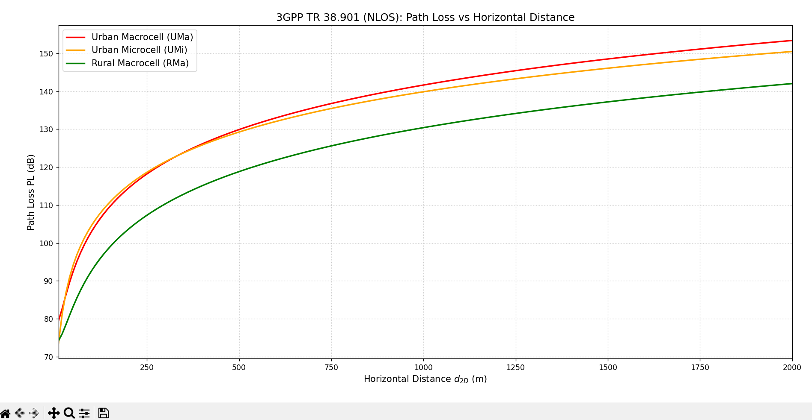

# 3GPP TR 38.901 Propagation Model for 5G

This repository contains the mathematical solutions and a Python simulation for the **3GPP TR 38.901** propagation model, focusing on Non-Line-of-Sight (NLOS) outdoor scenarios for 5G networks.

## 1. System Parameters

Based on the provided case study, we evaluate an outdoor 5G system operating at $f_c = 3.5\text{ GHz}$ with a horizontal distance $d_{2D} = 500\text{ m}$. The parameters are:

*   **Operating Frequency ($f_c$)**: 3.5 GHz[cite: 1]
*   **Horizontal Distance ($d_{2D}$)**: 500 m[cite: 1]
*   **Base Station Tx Power ($P_{t,BS}$)**: 46 dBm[cite: 1]
*   **Mobile Station Tx Power ($P_{t,UE}$)**: 23 dBm[cite: 1]
*   **User Terminal Height ($h_{UT}$)**: 1.5 m[cite: 1]
*   **Antenna Gains ($G_t = G_r$)**: 0 dBi (Isotropic)[cite: 1]
*   **No additional losses** (cable, penetration, shadowing)[cite: 1].

**Environment-Specific Parameters[cite: 1]:**
1.  **Urban Macrocell (UMa)**: $h_{BS} = 25\text{ m}$[cite: 1]
2.  **Urban Microcell (UMi)**: $h_{BS} = 10\text{ m}$[cite: 1]
3.  **Rural Macrocell (RMa)**: $h_{BS} = 35\text{ m}$, $h = 5\text{ m}$ (avg building height), $W = 20\text{ m}$ (street width)[cite: 1]

---

## 2. Analytical Solutions

### Question 1: 3D Distance ($d_{3D}$) Calculation
The 3D distance is calculated using the Pythagorean theorem:
$$d_{3D} = \sqrt{d_{2D}^2 + (h_{BS} - h_{UT})^2}$$

*   **UMa**: $d_{3D} = \sqrt{500^2 + (25 - 1.5)^2} = \sqrt{250000 + 552.25} = \mathbf{500.55\text{ m}}$
*   **UMi**: $d_{3D} = \sqrt{500^2 + (10 - 1.5)^2} = \sqrt{250000 + 72.25} = \mathbf{500.07\text{ m}}$
*   **RMa**: $d_{3D} = \sqrt{500^2 + (35 - 1.5)^2} = \sqrt{250000 + 1122.25} = \mathbf{501.12\text{ m}}$

---

### Question 2: Path Loss (PL) Calculation (NLOS)

Note: Since $h_{UT} = 1.5\text{ m}$, the height correction terms $(h_{UT} - 1.5)$ in UMa and UMi equations become exactly zero[cite: 1]. Also, for RMa, the correction term $3.2(\log_{10}(11.75 \times 1.5))^2 - 4.97$ approximates to $0$.

**A. Urban Macrocell (UMa):**
$$PL_{UMa} = 13.54 + 39.08\log_{10}(500.55) + 20\log_{10}(3.5) - 0$$
$$PL_{UMa} = 13.54 + 39.08(2.699) + 20(0.544)$$
$$PL_{UMa} = 13.54 + 105.49 + 10.88 = \mathbf{129.91\text{ dB}}$$

**B. Urban Microcell (UMi):**
$$PL_{UMi} = 35.3\log_{10}(500.07) + 22.4 + 21.3\log_{10}(3.5) - 0$$
$$PL_{UMi} = 35.3(2.699) + 22.4 + 21.3(0.544)$$
$$PL_{UMi} = 95.27 + 22.4 + 11.59 = \mathbf{129.26\text{ dB}}$$

**C. Rural Macrocell (RMa):**
$$PL_{RMa} = 161.04 - 7.1\log_{10}(20) + 7.5\log_{10}(5) - \left[24.37 - 3.7\left(\frac{5}{35}\right)^2\right]\log_{10}(35) + \left[43.42 - 3.1\log_{10}(35)\right][\log_{10}(501.12) - 3] + 20\log_{10}(3.5) - 0$$
$$PL_{RMa} = 161.04 - 9.24 + 5.24 - (24.29 \times 1.544) + (38.63 \times (-0.3)) + 10.88$$
$$PL_{RMa} = 161.04 - 9.24 + 5.24 - 37.50 - 11.59 + 10.88 = \mathbf{118.83\text{ dB}}$$

*(The Rural environment exhibits the lowest path loss, as expected due to fewer obstacles and wider propagation spaces).*

---

### Question 3: Received Signal Power (Downlink)
The signal travels from the Base Station to the User[cite: 1].
$$P_{r,DL} = P_{t,BS} + G_t + G_r - PL = 46 + 0 + 0 - PL$$
*   **UMa**: $46 - 129.91 =$ **$-83.91\text{ dBm}$**
*   **UMi**: $46 - 129.26 =$ **$-83.26\text{ dBm}$**
*   **RMa**: $46 - 118.83 =$ **$-72.83\text{ dBm}$**

---

### Question 4: Received Signal Power (Uplink)
The signal travels from the User Terminal back to the Base Station[cite: 1]. 
$$P_{r,UL} = P_{t,UE} + G_t + G_r - PL = 23 + 0 + 0 - PL$$
*   **UMa**: $23 - 129.91 =$ **$-106.91\text{ dBm}$**
*   **UMi**: $23 - 129.26 =$ **$-106.26\text{ dBm}$**
*   **RMa**: $23 - 118.83 =$ **$-95.83\text{ dBm}$**

*(Uplink is significantly weaker due to the low transmission power of the mobile device (23 dBm vs 46 dBm)[cite: 1]. In UMa and UMi environments, the received signal is extremely low).*

---

## 5. Python Simulation
This repository includes a Python script (`3gpp_38901_simulation.py`) that computes and visualizes the Path Loss ($PL$) vs. Horizontal Distance ($d_{2D}$) for all three environments. The simulated distance ranges from 10 m to 2000 m with a step of 10 m.

