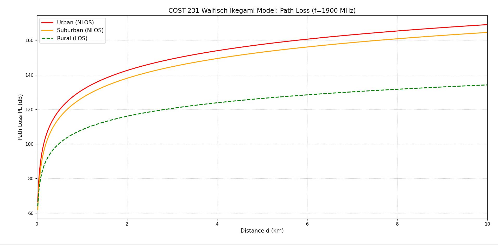

# COST-231 Walfisch-Ikegami Propagation Model

This repository contains the theoretical background, detailed step-by-step mathematical solutions, and analytical results for the **COST-231 Walfisch-Ikegami** empirical radio propagation model.

## 1. Theoretical Background & Equations

The COST-231 Walfisch-Ikegami model is a comprehensive radio propagation model designed for frequencies between **800 MHz and 2000 MHz**. It is highly effective for urban and suburban environments with uniform building structures. Unlike simpler empirical models, it accounts for the actual 3D geometry of a city, including building heights, street widths, building separation, and street orientation.

The model distinguishes between two main propagation scenarios:

### A. Line-of-Sight (LOS)
For conditions where there is direct optical contact between the transmitter and receiver, or for open rural environments where buildings do not obstruct the signal, the path loss is approximated using a modified free-space equation:
$$PL_{LOS}[dB] = 42.6 + 26\log_{10}(d) + 20\log_{10}(f)$$
*(where $d$ is the distance in km and $f$ is the frequency in MHz)*

### B. Non-Line-of-Sight (NLOS)
For urban and suburban environments where buildings obstruct the direct path, the total Path Loss ($PL$) is calculated as the sum of three distinct loss mechanisms:
$$PL_{NLOS}[dB] = L_{FS} + L_{rts} + L_{MSD}$$

1. **Free Space Loss ($L_{FS}$):** The basic attenuation in a vacuum.
   $$L_{FS} = 32.4 + 20\log_{10}(d) + 20\log_{10}(f)$$

2. **Roof-to-Street Diffraction and Scatter Loss ($L_{rts}$):** The loss the signal experiences as it diffracts from the rooftop of the last building down to the street level where the mobile user is located.
   $$L_{rts} = -16.9 - 10\log_{10}(w) + 10\log_{10}(f) + 20\log_{10}(\Delta h_{mobile}) + L_{ori}$$
   
   Where $w$ is the street width, $\Delta h_{mobile} = h_{roof} - h_{mobile}$, and $L_{ori}$ is the street orientation correction factor.*

3. **Multi-Screen Diffraction Loss ($L_{MSD}$):** The loss caused by the signal propagating over multiple building rooftops.
   $$L_{MSD} = L_{bsh} + k_a + k_d\log_{10}(d) + k_f\log_{10}(f) - 9\log_{10}(b)$$
   
   Where $b$ is the building separation distance. The parameters $L_{bsh}$, $k_a$, $k_d$, and $k_f$ are empirically derived constants depending on whether the base station is above or below the rooftops, and the size of the city.*

---

## 2. System Parameters (Case Study)

The calculations in this project are based on the following specific parameters:
* **Operating Frequency ($f$)**: 1900 MHz
* **Distance ($d$)**: 5 km
* **Base Station Tx Power ($P_{t,base}$)**: 43 dBm
* **Mobile Station Tx Power ($P_{t,mobile}$)**: 30 dBm
* **Base Station Height ($h_{base}$)**: 30 m
* **Mobile Height ($h_{mobile}$)**: 3 m
* **Average Roof Height ($h_{roof}$)**: 15 m
* **Street Width ($w$)**: 25 m
* **Building Separation ($b$)**: 50 m
* **Street Orientation Angle ($\Phi$)**: 30° (Urban), 25° (Suburban)
* **Antenna Gains**: Isotropic ($0 \text{ dBi}$) for both transmitter and receiver.

---

## 3. Step-by-Step Analytical Solutions

### Question 1: Path Loss Calculation for 3 Environments

**1. Rural Environment (LOS assumption)**
Using the LOS equation for open areas without building obstructions:
$$PL_{rural} = 42.6 + 26\log_{10}(5) + 20\log_{10}(1900)$$
$$PL_{rural} = 42.6 + 18.17 + 65.58 = \mathbf{126.35 \text{ dB}}$$

**2. Urban & Suburban Environments (NLOS)**
First, we calculate the common parameters for both scenarios:
* **$L_{FS}$**: $32.4 + 20\log_{10}(5) + 20\log_{10}(1900) = \mathbf{111.95 \text{ dB}}$
* **$\Delta h_{mobile}$**: $15\text{ m} - 3\text{ m} = \mathbf{12\text{ m}}$
* **$\Delta h_{base}$**: $30\text{ m} - 15\text{ m} = \mathbf{15\text{ m}}$ (Since $h_{base} > h_{roof}$, $k_a = 54$, $k_d = 18$)
* **$L_{bsh}$**: $-18\log_{10}(1 + 15) = \mathbf{-21.67 \text{ dB}}$

**A. Urban Environment (Metropolitan Center, $\Phi = 30^\circ$)**
* $L_{ori} = -10 + 0.35(30) = \mathbf{0.5 \text{ dB}}$
* $L_{rts} = -16.9 - 10\log_{10}(25) + 10\log_{10}(1900) + 20\log_{10}(12) + 0.5 = \mathbf{23.99 \text{ dB}}$
* $k_f = -4 + 1.5(\frac{1900}{925} - 1) = \mathbf{-2.42}$
* $L_{MSD} = -21.67 + 54 + 18\log_{10}(5) - 2.42\log_{10}(1900) - 9\log_{10}(50) = \mathbf{21.69 \text{ dB}}$
* **Total $PL_{urb}$** = $111.95 + 23.99 + 21.69 =$ **$157.63 \text{ dB}$**

**B. Suburban Environment (Medium Sized City, $\Phi = 25^\circ$)**
* $L_{ori} = -10 + 0.35(25) = \mathbf{-1.25 \text{ dB}}$
* $L_{rts} = 23.99 - 0.5 - 1.25 = \mathbf{22.24 \text{ dB}}$
* $k_f = -4 + 0.7(\frac{1900}{925} - 1) = \mathbf{-3.26}$
* $L_{MSD} = -21.67 + 54 + 18\log_{10}(5) - 3.26\log_{10}(1900) - 9\log_{10}(50) = \mathbf{18.93 \text{ dB}}$
* **Total $PL_{sub}$** = $111.95 + 22.24 + 18.93 =$ **$153.12 \text{ dB}$**

### Question 2: Received Signal Power (Downlink)
The base station transmits at $P_{tx} = 43 \text{ dBm}$. Assuming isotropic antennas, the received power at the mobile station is $P_{rx} = P_{tx} - PL$:
* **Urban**: $43 - 157.63 =$ **$-114.63 \text{ dBm}$**
* **Suburban**: $43 - 153.12 =$ **$-110.12 \text{ dBm}$**
* **Rural**: $43 - 126.35 =$ **$-83.35 \text{ dBm}$**

### Question 3: Received Signal Power at Base Station (Uplink)
The mobile phone transmits at $P_{tx} = 30 \text{ dBm}$. Assuming isotropic antennas, the received power at the base station is:
* **Urban**: $30 - 157.63 =$ **$-127.63 \text{ dBm}$**
* **Suburban**: $30 - 153.12 =$ **$-123.12 \text{ dBm}$**
* **Rural**: $30 - 126.35 =$ **$-96.35 \text{ dBm}$**

