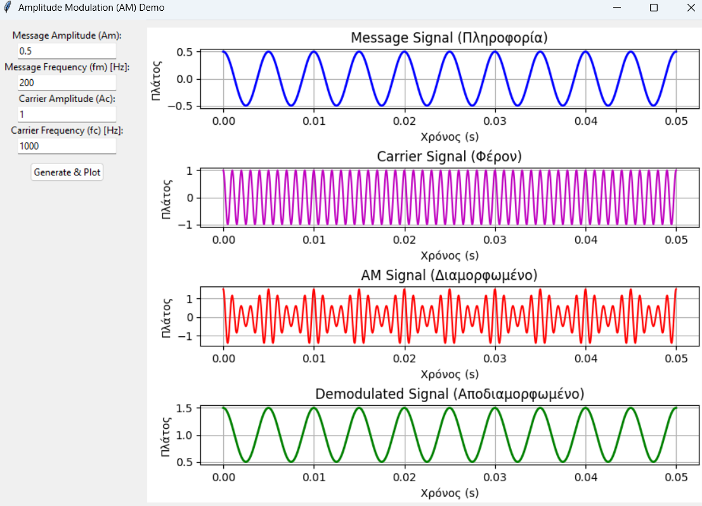

# Amplitude Modulation (AM) Simulation with GUI (Python)

## 1. Exercise Goal and Description

This exercise involves the development of a Python program with a **Graphical User Interface (GUI)** designed to simulate the fundamental processes of Amplitude Modulation (AM) and Demodulation.

The application allows the user to input critical parameters for both the message signal and the carrier wave, and then displays the resulting waveforms in the time domain.

## 2. Program Requirements and Inputs

The graphical interface must accept the following user-defined parameters:

| Parameter | Greek Terminology | Symbol |
| :--- | :--- | :--- |
| **Message Signal Amplitude** | *Πλάτος σήματος πληροφορίας* | $A_m$ |
| **Carrier Signal Amplitude** | *Πλάτος φέροντος* | $A_c$ |
| **Message Signal Frequency** | *Συχνότητα σήματος πληροφορίας* | $f_m$ |
| **Carrier Signal Frequency** | *Συχνότητα φέροντος* | $f_c$ |

## 3. Visual Outputs (Time Domain Plots)

The GUI is required to display four distinct time-domain diagrams:

1.  **Message Signal** (Modulating Wave)
2.  **Carrier Signal**
3.  **AM Modulated Signal**
4.  **AM Demodulated Signal**

## 4. Envelope Demodulation Principle

For the demodulation process, the program must implement the **Envelope Demodulation** technique. The envelope of the AM signal must be calculated and displayed based on the following relationship:

$$\mathbf{E(t) = A_c \cdot |1 + \mu \cdot \cos(2\pi f_m t)|}$$

Where:
* $E(t)$: The instantaneous value of the envelope.
* $A_c$: The Carrier Amplitude.
* $\mu$: The Modulation Index ($\mu = A_m / A_c$).
* $f_m$: The Message Signal Frequency.

---
