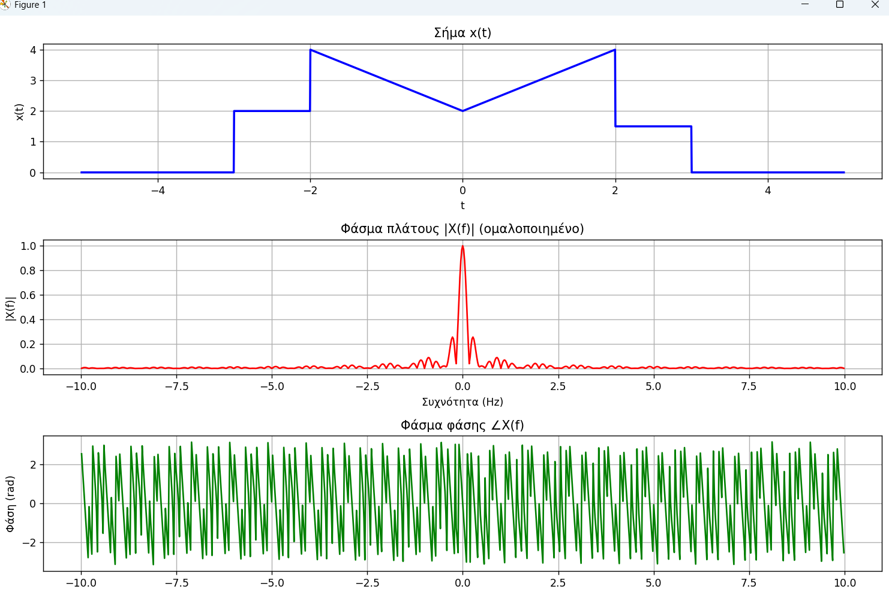

# 🎯 Exercise: Frequency Spectrum Analysis of a Signal

## 📝 Exercise Statement

**Objective:**  
Analyze the frequency behavior of a time-domain signal \( x(t) \) by determining:

1. The **Magnitude Spectrum** \( |X(f)| \)
2. The **Phase Spectrum** \( \angle X(f) \)

---

### Given Signal

The signal is defined as:

$$
x(t) =
\begin{cases}
2, & -3 \le t \le -2 \\
|t| + 2, & -2 < t < 2 \\
1.5, & 2 \le t \le 3 \\
0, & \text{otherwise}
\end{cases}
$$

---

### Task

1. Compute the **Fourier Transform** of the signal:

  $$
X(f) = \int_{-\infty}^{\infty} x(t) e^{-j 2\pi f t} \, dt
$$

2. Plot:
   - The **magnitude spectrum** \( |X(f)| \)
   - The **phase spectrum** \( \angle X(f) \)

3. Discuss the obtained results regarding the signal’s **frequency content** and **phase characteristics**.

---

## 📘 Theoretical Background

The **Fourier Transform** decomposes a time-domain signal into its frequency components:

$$
X(f) = \int_{-\infty}^{\infty} x(t) e^{-j 2\pi f t} \, dt
$$

The **Inverse Fourier Transform** reconstructs the time-domain signal:

$$
x(t) = \int_{-\infty}^{\infty} X(f) e^{j 2\pi f t} \, df
$$

### Magnitude and Phase Spectra

- **Magnitude:**

$$
|X(f)| = \sqrt{ \Re\{X(f)\}^2 + \Im\{X(f)\}^2 }
$$

- **Phase:**

$$
\angle X(f) = \tan^{-1}\left( \frac{\Im\{X(f)\}}{\Re\{X(f)\}} \right)
$$

The magnitude spectrum describes how **energy** is distributed across frequencies,  
while the phase spectrum encodes **time delay** and **symmetry** information.

---

## ⚙️ MATLAB Implementation 

### 📍 MATLAB Solution with FFT (Applied Version):Main Script (`sol1.m`)
 
This script analyze the frequency behavior of the given time-domain signal by determining:the **Magnitude Spectrum** and the **Phase Spectrum** by computing the **continuous Fourier Transform numerically** using FFT.

**Steps:**
1. Defines \( x(t) \) piecewise over time.  
2. Uses a fine sampling step `dt` and applies a **Fast Fourier Transform (FFT)**.  
3. Centers the frequency axis with `fftshift`.  
4. Extracts and smooths the **magnitude** and **phase spectra**.  
5. Plots:
   - The time-domain signal \( x(t) \)
   - The magnitude spectrum \( |X(j\omega)| \)
   - The phase spectrum \( \angle X(j\omega) \)

**Observations:**
- The **magnitude spectrum** shows: How strong the different frequency components are that make up the signal.
- We see peaks at specific frequencies corresponding to the "segments" of the signal. Since the signal is time-limited (non-zero only within certainintervals),its spectrum will be continuous and spread out.
- In the **phase spectrum** signal introduces frequency-dependent phase shifts, meaning each frequency component is delayed differently.
- The phase curve gradually drops as frequency increases. This is typical for signals that are not symmetric and contain delays or shifts in time.
- The smooth downward slope reflects time asymmetry—especially from the segment 𝑥(𝑡)=1.5 for 𝑡∈[2,3).
- After unwrapping, is **smooth** and nearly symmetric, confirming signal evenness.  
- High-resolution FFT (`N = 2^15`) ensures precise and clear results.

---

## 📊 MATLAB Results

- **Magnitude Spectrum:**  
  The discrete spikes decrease rapidly with harmonic order \( k \), consistent with a **triangular waveform**, whose coefficients decay as \( 1/k^2 \).

- **Phase Spectrum:**  
  The phase alternates between \( 0 \) and \( \pi \), confirming the **even symmetry** of the signal.

These results validate both the correctness of the MATLAB implementation and the expected theoretical properties of the signal.

---

## 🐍 Python Implementation

A continuous Fourier Transform approximation was implemented using **NumPy’s FFT**.

### Workflow Overview

1. Define the time-domain signal \( x(t) \) piecewise (with constant and triangular regions).  
2. Sample it densely over a time window.  
3. Apply **FFT** to compute \( X(f) \):
   $$
   X(f) = \mathcal{F}\{x(t)\}
   $$
4. Use `fftshift()` to center zero frequency.
5. Compute:
   - Normalized magnitude \( |X(f)| \)
   - Phase \( \angle X(f) \)
6. Plot the time-domain signal and both spectra.

---

## 📈 Python Results

- The **time-domain plot** correctly shows the composed shape of the signal.
- The **magnitude spectrum** displays smooth decay, indicating that higher frequencies carry less energy — typical for continuous piecewise signals.
- The **phase spectrum** rapid Phase Changes: the phase plot shows sharp transitions and periodic jumps. This is typical when the signal is not perfectly symmetric or contains discontinuities in its definition. These jumps often occur near frequencies where the amplitude approaches zero, due to numerical instability in np.angle.
- The phase is wrapped in the interval [-π,π], so when the true phase exceeds this range, it "jumps" by ±2π.
- The signal has asymmetric segments (e.g., the constant 1.5 from 𝑡=2 to 𝑡=3), which introduces non-zero phase components.

---

## 🔬 Mathematical Summary

For a periodic signal \( f(t) \) with period \( T \):

$$
a_k = \frac{1}{T} \int_T f(t) e^{-j 2\pi k t / T} \, dt
$$

and the reconstructed signal is:

$$
f(t) = \sum_{k=-\infty}^{\infty} a_k e^{j 2\pi k t / T}
$$

- MATLAB computes the **discrete Fourier series** coefficients \( a_k \).  
- Python (FFT) approximates the **continuous Fourier Transform** \( X(f) \).

---

## 📚 Conclusions

- Both MATLAB and Python accurately capture the frequency characteristics of \( x(t) \).
- The **magnitude spectrum** confirms that energy decreases with increasing frequency (expected for smooth signals).
- The **phase spectrum** validates the **signal’s symmetry** and **time-domain structure**.
- MATLAB focuses on **Fourier Series (discrete harmonics)**, while Python’s FFT shows a **continuous spectral approximation**.

---

## 🧾 References

- A. V. Oppenheim & A. S. Willsky, *Signals and Systems*, Prentice Hall.  
- R. Bracewell, *The Fourier Transform and Its Applications*, McGraw-Hill.  
- MATLAB Documentation: `quad`, `fft`, `angle`, `abs`.  
- NumPy & Matplotlib libraries for FFT visualization.
