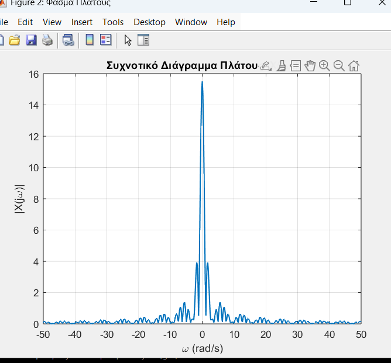
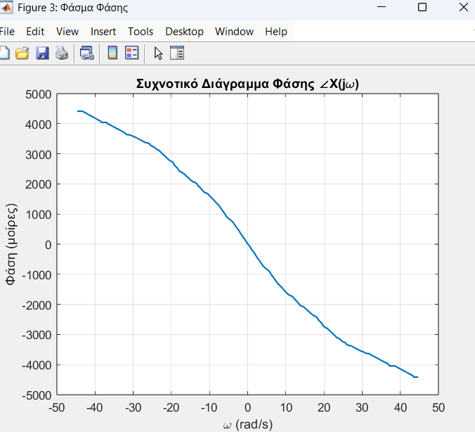
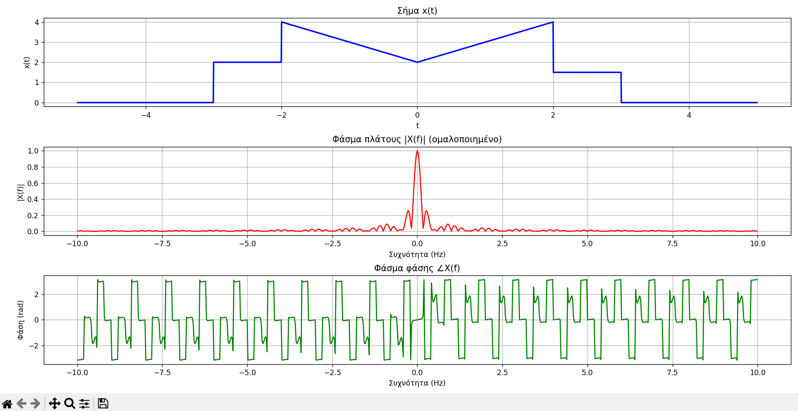

# 🎯 Exercise: Frequency Spectrum Analysis of a Signal

## 📝 Exercise Statement

**Objective:**  
Analyze the frequency behavior of a time-domain signal \( x(t) \) by determining:

1. The **Magnitude Spectrum** \( |X(f)| \)
2. The **Phase Spectrum** \( \angle X(f) \)

---

### Given Signal

The signal is defined as:

$$
x(t) =
\begin{cases}
2, & -3 \le t \le -2 \\
|t| + 2, & -2 < t < 2 \\
1.5, & 2 \le t \le 3 \\
0, & \text{otherwise}
\end{cases}
$$

---

### Task

1. Compute the **Fourier Transform** of the signal:

  $$
X(f) = \int_{-\infty}^{\infty} x(t) e^{-j 2\pi f t} \, dt
$$

2. Plot:
   - The **magnitude spectrum** \( |X(f)| \)
   - The **phase spectrum** \( \angle X(f) \)

3. Discuss the obtained results regarding the signal’s **frequency content** and **phase characteristics**.

---

## 📘 Theoretical Background

The **Fourier Transform** decomposes a time-domain signal into its frequency components:

$$
X(f) = \int_{-\infty}^{\infty} x(t) e^{-j 2\pi f t} \, dt
$$

The **Inverse Fourier Transform** reconstructs the time-domain signal:

$$
x(t) = \int_{-\infty}^{\infty} X(f) e^{j 2\pi f t} \, df
$$

### Magnitude and Phase Spectra

- **Magnitude:**

$$
|X(f)| = \sqrt{ \Re\{X(f)\}^2 + \Im\{X(f)\}^2 }
$$

- **Phase:**

$$
\angle X(f) = \mathrm{atan2}\!\bigl(\Im\{X(f)\},\,\Re\{X(f)\}\bigr)
$$

The magnitude spectrum describes the strength of the signal's frequency components; its squared magnitude is related to energy distribution. The phase spectrum describes the phase of each frequency component and reflects the signal's time-domain structure.

---

## ⚙️ MATLAB Implementation 

### 📍 MATLAB Solution with FFT (Applied Version):Main Script (`sol1.m`)
 
This script analyzes the frequency behavior of the given time-domain signal by approximating its **continuous Fourier Transform** numerically with the FFT.

**Steps:**
1. Defines \( x(t) \) piecewise over time.
2. Samples it with a time step `dt` and scales the FFT by `dt` to approximate the Fourier integral.
3. Centers the frequency axis with `fftshift` and expresses it in rad/s.
4. Computes the magnitude and wrapped phase. Phase values below a relative magnitude threshold are omitted because phase is unreliable near spectral zeros.
5. Plots:
   - The time-domain signal \( x(t) \)
   - The magnitude spectrum \( |X(j\omega)| \)
   - The phase spectrum \( \angle X(j\omega) \)

**Interpretation and limitations:**
- Since the signal is time-limited and nonperiodic, its Fourier transform is continuous; the FFT provides samples of a numerical approximation to that transform.
- The signal is real but not even: its values on \([-3,-2]\) and \([2,3]\) differ. Therefore, its transform generally has a nonzero phase. For a real signal, \(X(-f)=X^*(f)\), so the magnitude is even and the phase is odd modulo phase wrapping, away from spectral zeros.
- The signal has jump discontinuities, so its high-frequency magnitude generally decays on the order of \(1/|f|\), with zeros and local variations.
- Zero-padding (`N = 2^15`) makes the plotted frequency grid denser; it does not improve the underlying frequency resolution.
- The MATLAB script corrects for the time axis starting at \(t=-5\) by multiplying the FFT by \(e^{-j\omega t(1)}\). Its phase plot shows the wrapped phase in radians without centering or smoothing it; low-magnitude values are omitted because phase is unreliable near spectral zeros.




---

## 📊 MATLAB Results

- **Magnitude Spectrum:** The script plots the magnitude of the numerically approximated continuous Fourier transform. Because the signal is real, the magnitude should be even. The time-limited signal has a continuous spectrum, not discrete Fourier-series harmonics.
- **Phase Spectrum:** The signal is not even, so its phase is not generally restricted to \(0\) and \(\pi\). For a real signal, the phase is odd modulo \(2\pi\) where the magnitude is nonzero. The MATLAB script applies the time-origin correction and plots the wrapped phase in radians, omitting values at low magnitudes.

---

## 🐍 Python Implementation

A numerical approximation to the continuous Fourier transform is implemented using **NumPy's FFT**.

### Workflow Overview

1. Define the time-domain signal \( x(t) \) piecewise.
2. Sample it over a time window and compute the sample interval `dt`.
3. Apply the FFT, multiply by `dt` to approximate the Fourier integral, and correct for the time axis starting at \(t=-5\):
   $$
   X(f) \approx dt \sum_n x(t_n)e^{-j2\pi f t_n}
   $$
4. Use `fftshift()` to center zero frequency and zero-padding to obtain a denser frequency grid for plotting.
5. Plot the normalized magnitude and phase over the range from -10 Hz to 10 Hz.



---

## 📈 Python Results

- The **time-domain plot** shows the sampled piecewise signal.
- The **magnitude spectrum** is normalized to its peak, so it shows relative magnitude rather than the absolute scale of \(X(f)\). It is even because the signal is real.
- The **phase spectrum** is wrapped to \([-\pi,\pi]\). Apparent jumps can occur at the wrapping boundary and near spectral zeros, where phase is poorly defined.
- The signal is not even, so its phase is generally nonzero. The time-origin correction in the script accounts for the samples starting at \(t=-5\).

### Tests

Run the signal and Fourier-transform tests from the repository root with:

```bash
python -m unittest discover -s freq_diag -p "test_*.py" -v
```

---

## 🔬 Mathematical Summary

For a periodic signal \( f(t) \) with period \( T \), its Fourier-series coefficients are:

$$
a_k = \frac{1}{T} \int_T f(t) e^{-j 2\pi k t / T} \, dt
$$

and the signal can be reconstructed as:

$$
f(t) = \sum_{k=-\infty}^{\infty} a_k e^{j 2\pi k t / T}
$$

The signal in this exercise is nonperiodic, so this Fourier-series representation does not describe it. Both scripts use the FFT to approximate samples of its continuous Fourier transform; the MATLAB frequency axis is in rad/s, while the Python frequency axis is in Hz.

---

## 📚 Conclusions

- Both scripts use an FFT to approximate the continuous Fourier transform of the nonperiodic, time-limited signal; the FFT output is sampled on a discrete frequency grid.
- Because the signal is real, its magnitude spectrum is even. Because it is not even, its phase is generally nonzero; for a real signal, the phase is odd modulo \(2\pi\) where the spectrum is nonzero.
- The signal has jump discontinuities, so its high-frequency magnitude generally decays on the order of \(1/|f|\), rather than following the \(1/k^2\) harmonic decay of a triangular periodic waveform.
- Both scripts include the time-origin correction before plotting the phase.

---

## 🧾 References

- A. V. Oppenheim & A. S. Willsky, *Signals and Systems*, Prentice Hall.  
- R. Bracewell, *The Fourier Transform and Its Applications*, McGraw-Hill.  
- MATLAB Documentation: `quad`, `fft`, `angle`, `abs`.  
- NumPy & Matplotlib libraries for FFT visualization.
